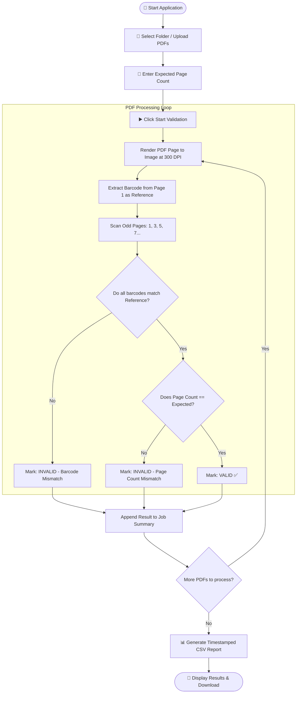

# 📄 PROJECT DOCUMENTATION: PDF BARCODE VALIDATOR SYSTEM

---

## 📌 Executive Summary
The **PDF Barcode Validator** is an automated quality assurance and verification system designed for academic institutions, examination cells, and document processing centers. It automates the verification of barcodes across multi-page PDF documents (such as examination answer booklets) to ensure booklet integrity, eliminate manual verification overhead, and prevent student booklet mix-ups.

This document covers the complete architecture, modules, algorithms, flowcharts, and technical specifications for both the **Desktop Python Application** and the **ASP.NET Core Web Integration**.

---

## 1️⃣ System Overview & Core Logic

### 🎯 Purpose
In traditional examination evaluation workflows, answer sheets and barcodes are checked manually. Manual inspection is:
- ⏳ **Slow & Labor-Intensive**
- ⚠️ **Error-Prone** (human fatigue over thousands of pages)
- ❌ **Difficult to Audit** without digital logs

### ⚙️ How the Validation Engine Operates
1. **Input Batch**: The user selects a folder containing PDF files or uploads them in bulk.
2. **Page-by-Page Rendering**: Each PDF is rendered into high-resolution images (300 DPI) for barcode decoding.
3. **Reference Barcode Identification**:
   - The barcode detected on **Page 1 (first odd page)** is stored as the **Reference Barcode**.
4. **Odd-Page Comparison**:
   - Barcodes on subsequent odd pages (Pages 3, 5, 7, ...) are extracted and compared strictly against the Reference Barcode.
5. **Expected Page Verification**:
   - Total pages found are checked against the expected booklet count (e.g., 24, 32, 40 pages).
6. **Classification & Final Status**:
   - `VALID` ✅ : All odd-page barcodes match and total page count matches expected count.
   - `INVALID (Barcode Mismatch)` ⚠️ : Any page contains a barcode different from Page 1.
   - `INVALID (Pages Count not Match)` ❌ : Missing expected pages.
   - `ERROR` 🚫 : File corruption or unreadable PDF.
7. **Report Generation**: An automated timestamped CSV report is generated summarizing every file.

---

## 2️⃣ Architecture & Process Flowchart



---

## 3️⃣ System Requirements & Technical Stack

### 💻 System Specifications
- **Operating System**: Windows 10 / Windows 11 / Windows Server
- **Processor**: Intel Core i3 / AMD Ryzen 3 or higher
- **RAM**: 4GB Minimum (8GB+ recommended for large PDF batches)
- **Storage**: Sufficient space for temporary PDF rendering buffers

---

### 📦 Python Desktop Edition

#### Core Dependencies:
| Library | Purpose |
|---|---|
| `opencv-python` (`cv2`) | Computer vision filters (grayscale, thresholding, contrast enhancement) |
| `numpy` | High-performance image array processing |
| `pandas` | Structured tabular data manipulation and CSV report generation |
| `pyzbar` | 1D/2D Barcode extraction and decoding |
| `PyMuPDF` (`fitz`) | Fast 300 DPI PDF rendering to image buffers |
| `Pillow` (`PIL`) | GUI image loading and resizing |
| `tkinter` | Native cross-platform desktop user interface |

#### Installation:
```bash
pip install opencv-python numpy pandas pyzbar pymupdf pillow pyinstaller
```

#### Standalone Executable (.exe) Build:
```bash
pyinstaller --onefile --noconsole --icon=icon.ico original_python.py
```

---

### 🌐 ASP.NET Core Web Edition (.NET 8)

#### Core Dependencies:
| Package | Version | Purpose |
|---|---|---|
| `Docnet.Core` | `2.6.0` | Native Windows/Linux PDF rendering engine |
| `ZXing.Net` | `0.16.11` | Multi-format 1D & 2D barcode reading algorithms |
| `Microsoft.AspNetCore.App` | `8.0` | High-performance asynchronous web server |

---

## 4️⃣ Detailed Module Breakdown

### 🔹 1. Folder Selection & Upload Module
- **Desktop (Tkinter)**: Uses `filedialog.askdirectory()` for local directory selection and counts `.pdf` files.
- **Web (ASP.NET Core)**: Implements HTML5 Drag-and-Drop Dropzone with support for 1GB+ multipart upload batches.

### 🔹 2. PDF Rendering Engine
- Converts PDF pages into 300 DPI raw pixel streams (`BGRA32`).
- Renders page-by-page in memory to eliminate hard-disk clutter.

### 🔹 3. Barcode Detection & Computer Vision Module
- Applies multi-region scanning:
  - **Full-page scan**
  - **Header crop (top 40%)** where booklet barcodes are typically placed
  - **Footer crop (bottom 40%)**
  - **Inverted luminance filtering** to read white-on-black or faded barcodes
- Supports formats: `Code 128`, `Code 39`, `EAN-13`, `QR Code`, `DataMatrix`, `PDF-417`, `ITF`, `Codabar`.

### 🔹 4. Validation & Comparison Engine
- Compares each detected barcode with the Page 1 reference string.
- Logs specific mismatching page numbers and conflicting values (e.g. `Page 5: AUS982341 != AUS982340`).
- Identifies missing odd pages if the total pages count is less than the expected threshold.

### 🔹 5. Asynchronous Job & Cancellation Tracker
- Executes validation in a background thread to prevent UI freezing.
- Real-time calculations:
  - **Elapsed Time**: `TimeSpan(Now - StartedAt)`
  - **Estimated Remaining Time (ETA)**: `(Elapsed / Processed) * RemainingFiles`
  - **CancellationToken Support**: Safe immediate aborting when user clicks "Cancel".

### 🔹 6. Reporting & Export Module
- Generates a standard RFC-4180 compliant CSV document with the following schema:
  - `Sr No`: Sequential index
  - `Folder Name`: Source folder or upload ID
  - `File Name`: Name of the PDF
  - `Total PDFs in Folder`: Batch count
  - `Expected Pages`: User configured target
  - `Total Pages Found`: Detected pages
  - `Reference Barcode`: Primary barcode value
  - `Mismatch Pages`: List of offending pages
  - `Mismatch Details`: Exact string values
  - `Missing Pages Count`: Page deficit
  - `Final Status`: VALID / INVALID / ERROR
  - `Processed Time`: Timestamp formatted as `dd-MM-yyyy HH:mm:ss`

---

## 5️⃣ Screen & Workflow Walkthrough

| Step | Screen | Description |
|---|---|---|
| **1** | **Input & Setup Screen** | User selects folder / drags PDF files and inputs expected page count (e.g., `24`). |
| **2** | **Processing Screen** | Real-time progress bar, animated spinner, elapsed timer, countdown ETA, and active file indicator. |
| **3** | **Live Results Table** | Tabular display showing status badges (`VALID ✅`, `MISMATCH ⚠️`, `MISSING ❌`) with instant filter pills. |
| **4** | **Report Export** | Direct download button enabled upon completion for offline analysis and auditing. |

---

## 6️⃣ CSV Output Schema Reference

```csv
Sr No,Folder Name,File Name,Total PDFs in Folder,Expected Pages,Total Pages Found,Reference Barcode,Mismatch Pages,Mismatch Details,Missing Pages Count,Final Status,Processed Time
1,ExamBatch_A,Booklet_001.pdf,50,24,24,AUS100234,-,-,0,VALID,30-09-2026 14:05:12
2,ExamBatch_A,Booklet_002.pdf,50,24,24,AUS100235,5,Page 5: AUS999999,0,INVALID (Barcode Mismatch),30-09-2026 14:05:14
3,ExamBatch_A,Booklet_003.pdf,50,24,20,AUS100236,21, 23,-,4,INVALID (Pages Count not Match),30-09-2026 14:05:16
```
